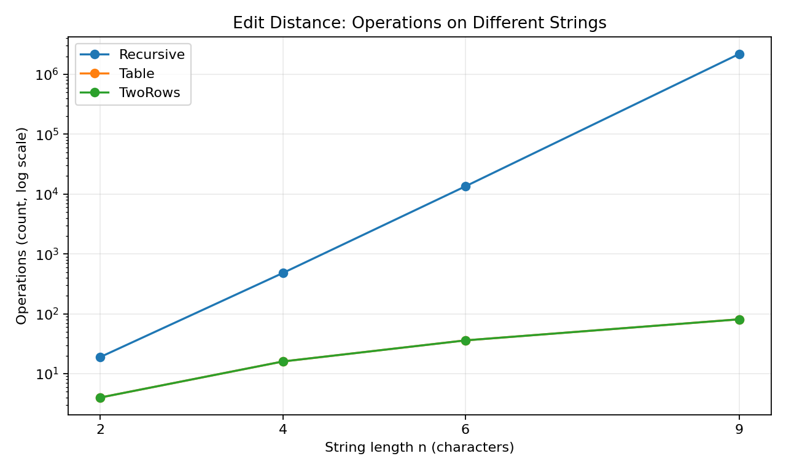
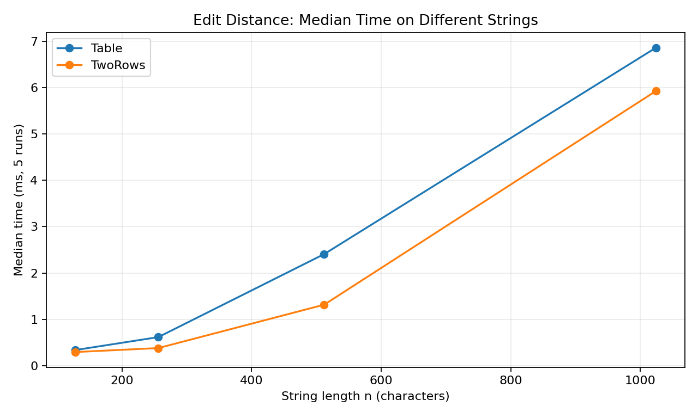
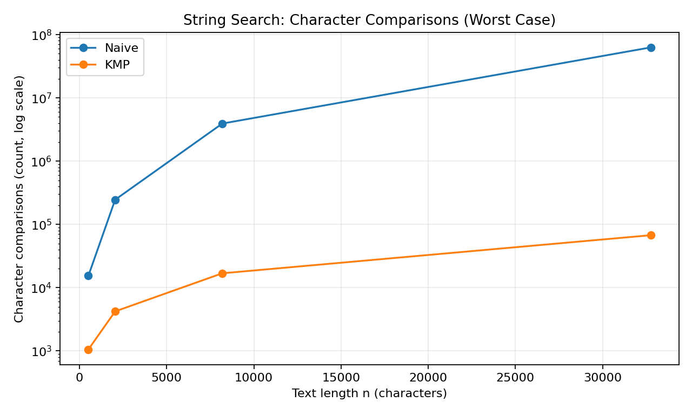
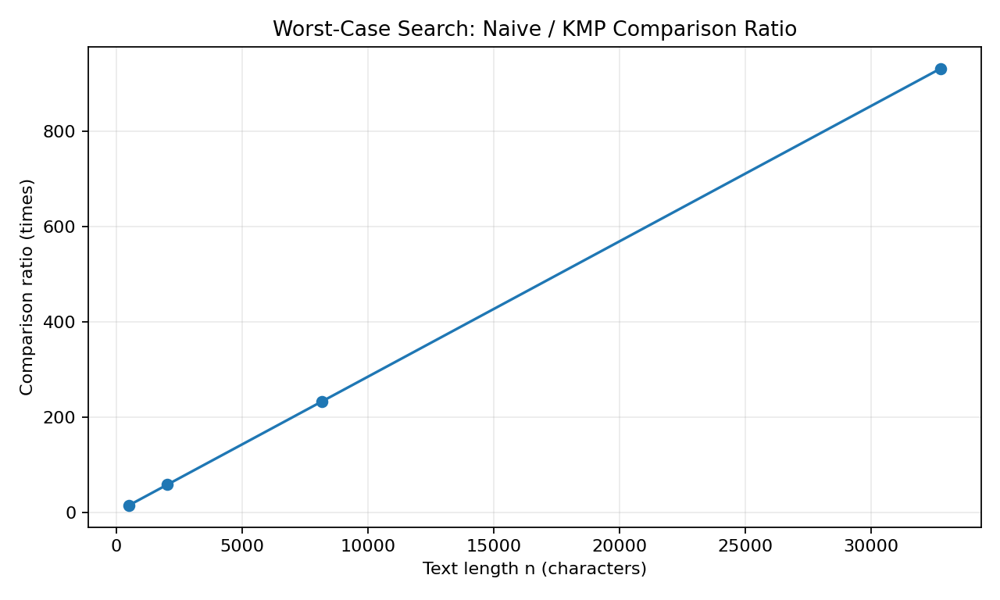

# Assignment 4 — Experiment Report

**Student:** Begaliev Bakdaulet  
**Group:** SE-2526  
**Topic:** City Search & Spell-Check  
**Environment:** OpenJDK 21 (Java source target: 17), November 5, 2026

## 1. Experiment Design Card

| Field | Design |
|---|---|
| **Question** | Edit Distance: how quickly does plain recursion become expensive compared with DP? Search: how do Naive and KMP behave on normal and deliberately difficult text? |
| **Sizes (n)** | Recursive: 2, 4, 6, 9. Table/Two Rows: 2, 4, 6, 9, 128, 256, 512, 1024. Search: 512, 2048, 8192, 32768. All families have at least four sizes and a maximum greater than four times the minimum. |
| **Inputs** | Edit: `same` (a seeded random string compared with itself) and `different` (A repeated n times vs B repeated n times). Search: `random` (seeded text with a substring chosen as the pattern) and `worst` (A repeated n times vs a pattern of A characters followed by B). Search pattern length is n/16. |
| **Metrics** | `operations`: actual recursive calls, updated DP cells, or character comparisons (for KMP, both LPS building and searching). Time is in milliseconds, five runs per input; comparisons use counters so they do not depend on computer speed. |
| **Prediction** | Recursion should grow rapidly for different strings. Both DP methods should fill n² cells, but two rows should use less memory. Naive search should do much more work on the worst input; KMP should grow close to linearly. |
| **Plots** | Edit operations (log scale), DP median time, search comparisons (log scale), and Naive/KMP worst-case comparison ratio. |

A fixed seed (`20261105`) generates the same input strings each time. Every configuration has one warm-up run and five measured runs. `results/results.csv` has **280 data rows**, one for each measured run; the charts use the median of those runs for time measurements. Counter values repeat exactly for identical inputs, while timing can vary between computers.

## 2. Results and Plots

**Takeaway:** On different strings of length 9, recursion made 2,193,844 calls, but either DP method computed only 81 cells.

**Takeaway:** Full-table and two-row DP both scale with n²; their timings are close, and the two-row version usually used less time in this run.

**Takeaway:** On the worst text of length 32,768, Naive needed 62,916,608 character comparisons versus only 67,582 for KMP.

**Takeaway:** As the pattern length increases with the text length, the Naive/KMP comparison ratio grows, reaching about 931 to 1.

### Selected measured values

Medians are from five runs on this computer; the operation counts were collected inside the algorithms.

| Algorithm and input | n | Operations | Median time (ms) |
|---|---:|---:|---:|
| Recursive / different | 9 | 2,193,844 | 14.549 |
| Table / different | 1024 | 1,048,576 | 6.864 |
| Two Rows / different | 1024 | 1,048,576 | 5.928 |
| Naive / worst | 32768 | 62,916,608 | 122.471 |
| KMP / worst | 32768 | 67,582 | 0.537 |

## 3. Prediction vs Result

**Edit Distance:** I predicted that the no-memory recursive version would repeat many states when characters differ. That happened: at n=9 it already made over two million function calls, while each DP version filled only 81 inner cells. At n=1024 the two DP methods both filled 1,048,576 cells, as expected for O(nm); two rows saved memory, not the number of states calculated.

**String search:** I expected Naive to struggle on long repeated prefixes and KMP to avoid rechecking most of them. The 32,768-character worst input confirmed this with about 63 million Naive comparisons versus about 68 thousand for KMP. On random input, both methods were much closer because Naive usually stops comparing early.

## 4. Short Answers

**Which input made string search slowest, and why?**  
The slowest case was Naive search on the `worst` text of length 32,768. The text contains only A characters, while the pattern has many A characters and ends in B. Naive repeatedly checks nearly the whole pattern before finding a mismatch, so the work becomes very large.

**How large an n could recursive Edit Distance handle, and what stopped it?**  
The largest recursive size used in my experiment was n=9, which completed in a median of 14.549 ms. It already needed 2,193,844 recursive calls on different strings. I intentionally did not test much larger sizes because the number of calls grows very quickly, making recursion impractical as the input grows.

**What do you gain and lose with two rows?**  
Two rows reduce extra memory from O(nm) to O(m) because only the current and previous rows are stored. The method still returns exactly the same minimum edit distance as the full table. It does not preserve the whole table, so showing the complete DP grid or reconstructing a sequence of edits would require additional work.

**Which search would you choose for the city platform?**  
I would use KMP for searching long text and log files because its worst-case time is O(n+m). It uses a small LPS array and does not move backwards through the text. Naive is easier to write, but difficult repeated-prefix inputs can make it much slower.

## 5. A Note on Time

The measured times generally support the operation counts, but some small inputs ran in fractions of a millisecond, where JVM warm-up, CPU scheduling, and other background activity make timings noisy. For example, the large search test showed 122.471 ms for Naive and 0.537 ms for KMP in this run, but these exact milliseconds are machine-dependent. For this reason, I recorded all five runs and report their median, while also relying on actual comparisons, calls, and DP-cell counts to explain the algorithmic behavior.

**Conclusion:** Dynamic programming avoids the repeated work of plain recursion, and the two-row version keeps its result with much less memory. For repeated-prefix searching, KMP is a safer choice than Naive because the LPS array prevents unnecessary character rechecks.
